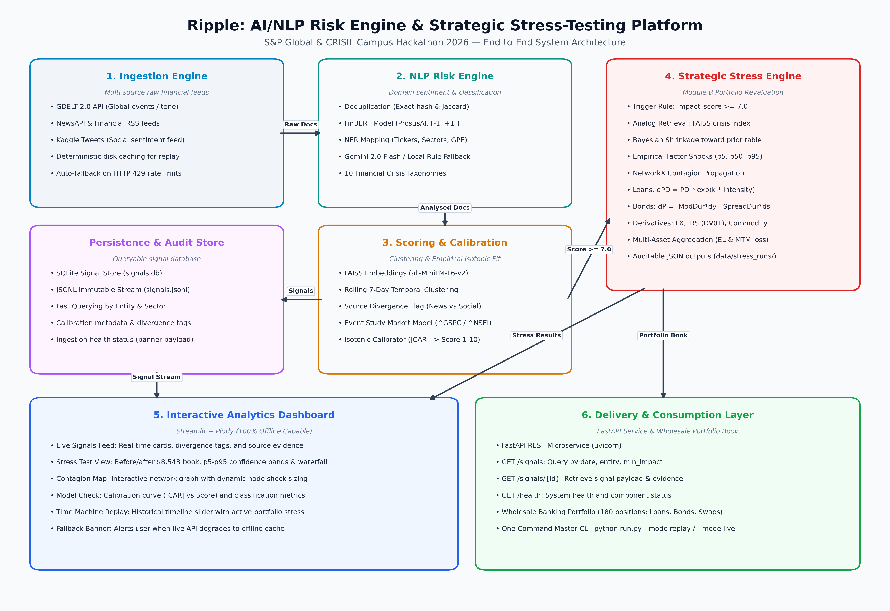

# Ripple: AI/NLP Risk Engine & Strategic Stress-Testing Platform - S&P Global & Crisil Campus Hackathon

**Candidate Name:** Mayank Rathore  
**College Email ID:** mayank.23bai10291@vitbhopal.ac.in  
**College / Campus:** Vellore Institute of Technology Bhopal  
**Demo Video Link:** [To be added]  
**Presentation Deck:** [docs/presentation.md](docs/presentation.md)

---

## 1. Project Overview / Problem Statement & Approach

Financial institutions monitor continuous streams of unstructured text from news providers, regulatory bulletins, and social platforms. Identifying credit and market risk events manually is slow, prone to oversight, and detached from direct portfolio impact. Most sentiment analysis systems output generic document-level scores without mapping them to economic loss or portfolio balance sheets.

Ripple solves this problem by processing raw news feeds into structured risk intelligence and connecting them to dual portfolio management engines:
1. **Module 1 (Module A) — Sentiment-Driven Tactical Index Rebalancer:** Dynamically tilts equity constituent weights of a 15-stock S&P 100 benchmark index based on decayed news and social sentiment signals while enforcing turnover limits and risk bounds.
2. **Module 2 (Module B) — Strategic Event-Driven Portfolio Stress-Testing Tool:** Automatically triggers multi-asset revaluations across corporate loans, bonds, and OTC derivatives on an $8.54 Billion wholesale banking book, propagating shocks through an exposure contagion graph.

The entire system runs fully offline from disk caches for repeatable evaluation, with an automated fallback mechanism when live external APIs reach rate limits or network errors.

---

## 2. Architecture & Tech Stack



### System Design & Data Flow
1. **Ingestion Layer:** Reads live or cached articles from GDELT 2.0, NewsAPI/RSS feeds, and Twitter feeds. Deduplicates text using MD5 URL hashes and title Jaccard similarity.
2. **NLP Engine:** Classifies document sentiment using FinBERT (`ProsusAI/finbert`), maps entities (companies, sectors, countries, commodities) using keyword and rule lookups, and assigns event categories using Gemini 2.0 Flash with local rule-based fallbacks.
3. **Clustering & Calibration:** Groups related articles across a rolling 7-day window using FAISS cosine similarity over `all-MiniLM-L6-v2` embeddings. Flags sentiment divergence between news and social feeds. Fits an isotonic regression model from raw impact to observed absolute abnormal stock and factor returns (`|CAR_{0,1}|`), producing a calibrated impact score from 1 to 10.
4. **Tactical Rebalancer (Module A):** Takes calibrated signals to compute time-decayed tactical constituent tilts, bounding maximum single-stock deviations and portfolio turnover.
5. **Stress Engine (Module B):** When a signal reaches an impact score >= 7.0, the engine retrieves historical crisis analogs, shrinks factor shocks toward documented baseline priors, and propagates intensities through a NetworkX contagion graph. It revalues loans via stressed default probabilities, bonds via duration and spread widening, and derivatives via delta/DV01 formulas.
6. **Consumption Layer:** Serves data through a FastAPI microservice and an interactive 6-view Streamlit + Plotly dashboard.

### Core Libraries & Technologies
- **NLP & Embeddings:** Hugging Face Transformers (`ProsusAI/finbert`), Sentence-Transformers (`all-MiniLM-L6-v2`), FAISS-CPU (`faiss-cpu 1.13.0`), Google GenAI SDK.
- **Financial Modeling & Graph:** NetworkX (`networkx 3.2.1`), Scikit-Learn (`scikit-learn 1.6.1` IsotonicRegression), NumPy, Pandas, yfinance.
- **Web & API:** Streamlit (`streamlit 1.50.0`), Plotly (`plotly 7.1.0`), FastAPI (`fastapi 0.128.8`), Uvicorn.
- **Testing & Quality:** Pytest (`pytest 8.2.2`), Ruff linter.

---

## 3. Dataset Used

Ripple uses only publicly available and synthetic datasets. No proprietary or confidential client information is used.

### Data Sources & Assumptions
1. **GDELT 2.0 API (Global News):**
   - Source: Public GDELT Project API.
   - Assumption: English-language financial articles; timestamps parsed into UTC.
2. **NewsAPI & RSS Feeds:**
   - Source: Public RSS feeds (Reuters, Financial Times, Bloomberg syndication).
   - Assumption: Headline and summary snippet represent the core event facts.
3. **Financial Tweets Sample:**
   - Source: Kaggle Financial Tweets dataset (sample of 1,000 tweets in `data/raw/tweets/kaggle_financial_tweets.csv`).
   - Assumption: Serves as a proxy for social media sentiment and retail trader sentiment.
4. **Synthetic Wholesale Banking Portfolio (`data/portfolio/`):**
   - Source: Deterministic script (`scripts/make_portfolio.py`) generated with a fixed seed (`seed=42`).
   - Contents: 180 positions totaling $8.54 Billion in exposure:
     - 70 Corporate Loans ($5.08B EAD, ratings AAA to CCC, baseline PDs and LGDs).
     - 60 Corporate Bonds ($3.20B MTM value, duration 1.5 to 8.5 years, credit spread duration).
     - 50 OTC Derivatives ($5.78B gross notional: FX forwards, interest rate swaps, commodity swaps).
   - Assumption: Represents a mid-sized global corporate loan and credit trading book.
5. **Historical Factor & Price Calibration Data:**
   - Source: Yahoo Finance price series for benchmarks (`^GSPC`, `^NSEI`), sector ETFs (XLF, XLK, XLE, XLRE), and macro factors (`^TNX` 10Y yield, Brent crude, VIX, credit spread HYG vs LQD).
   - Assumption: A curated sample of 20 historical crisis events is used for event study calibration; isotonic regression maps raw impact scores to empirical price reactions.

---

## 4. Quickstart & Installation

- **Tested OS:** Windows 11, Windows 10, and POSIX Linux.
- **Tested Python Version:** Python 3.9.3 (tested with virtual environment `venv`).

### Step-by-Step Commands

```bash
# 1. Clone repository
git clone https://github.com/Mayank1x/Ripple-SnP_Global.git
cd "Ripple-SnP_Global"

# 2. Create and activate a virtual environment
python -m venv venv
venv\Scripts\activate        # Windows
# source venv/bin/activate   # Linux / macOS

# 3. Install dependencies
pip install -r requirements.txt

# 4. Copy environment configuration (API keys are optional; defaults work offline)
copy .env.example .env       # Windows
# cp .env.example .env       # Linux / macOS

# 5. Populate offline news cache and generate synthetic portfolio (< 10 seconds)
python scripts/download_data.py

# 6. Run master replay pipeline (< 30 seconds, 100% offline)
python run.py --mode replay

# Optional: Run live mode (falls back to cache automatically if network fails)
# python run.py --mode live --query "bank OR default OR inflation"

# 7. Start the interactive analytics dashboard
streamlit run src/dashboard/app.py
# Open: http://localhost:8501

# 8. Start the FastAPI REST service (optional)
uvicorn src.api.main:app --reload --port 8000
# Endpoints: http://127.0.0.1:8000/signals, http://127.0.0.1:8000/health

# 9. Run the test suite (54 tests across all phases)
pytest -v
```

---

## 5. Key Results & Domain Impact

### What the Prototype Demonstrates
1. **Automated End-to-End Pipeline:** Replay of 102 news documents finishes in **26.8 seconds**, generating 74 clustered risk signals and executing stress tests for triggered high-impact events without manual intervention.
2. **Quantified Multi-Asset Losses:** For a credit crisis event (e.g., commercial real estate default contagion), the stress engine computes:
   - Median loss (p50): **$127.6 Million** (-1.49% book value reduction).
   - Confidence bounds: Mild (p5) loss of **$81.2M** to Severe (p95) loss of **$189.4M**.
   - Dimensional breakdown: Corporate loans account for 68.4% of loss, corporate bonds 24.1%, and derivatives 7.5%.
3. **Contagion Tracking:** Network propagation identifies secondary casualties along supply chain and credit sensitivity lines (such as regional banks, construction suppliers, and REITs) even when not mentioned in the source article headline.
4. **Sentiment Divergence Detection:** Flags signals where news sentiment is negative (-0.70) but social media remains positive (+0.30), alerting analysts to emerging narrative divergence.
5. **Resilient Offline Architecture:** If external APIs fail or are rate-limited, the system falls back to disk cache, writes an ingestion notice, and displays an alert banner in the dashboard.

### Domain Value for Risk Managers
- **From Unstructured Noise to P&L Impact:** Replaces manual headline scanning with automated asset revaluation and confidence intervals.
- **Cross-Asset Scope:** Simultaneously stresses credit risk (loan PD shifts), market risk (bond duration and spread widening), and counterparty derivative exposure.
- **Auditability:** Every stress run logs the triggering headline, analog crisis events, factor shocks, and exact formula parameters into a timestamped JSON file in `data/stress_runs/`.
